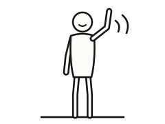

# A parcel for you

A hand-made, interactive personal website. Visitors cut the tape on a parcel,
peer into the dark box, look down into it, move a pile of clothes aside, and
find a little instruction booklet about you underneath.
Plain HTML, CSS and JavaScript — no build step — hosted on GitHub Pages.

## Preview it on your computer

You need [Node.js](https://nodejs.org) (any recent version).

```bash
npm run serve        # then open http://127.0.0.1:4173
```

Jump straight to a stage while you work (handy when editing the book):

| URL | Shows |
| --- | --- |
| `http://127.0.0.1:4173/?jump=dark` | the opened, dark box |
| `http://127.0.0.1:4173/?jump=overhead` | the view down into the box, clothes and all |
| `http://127.0.0.1:4173/?jump=clear` | the same, with the clothes already moved off the booklet |
| `http://127.0.0.1:4173/?jump=book` | the open booklet |

The browser console (F12) lists every placeholder that is still in use.

## Make it yours

Everything you are meant to change lives in **`content/`** and **`assets/`**.

### 1. The introduction booklet — `content/book.md`

The booklet looks like a black-and-white assembly manual: numbered steps,
line drawings, a parts list, plain type. Every `[Placeholder — …]` in the file
is waiting for your own words. A quick reference sits at the top of the file:

```markdown
# Page title                   (not numbered)
## Step title                  numbered for you: 1, 2, 3… through the whole booklet
### Small heading
A paragraph. Leave an empty line between paragraphs.
> A note — shown in a box with a "!"
- A list item
- 2× socks                     a number and × make a parts-list line
**bold**  *italic*  ==highlighted words==  [a link](https://example.com)

---                            ← three dashes start a new page
```

Ready-made line drawings live in `assets/manual/`: `figure-wave`,
`figure-read`, `figure-think`, `figure-phone`, `two-people`, `parts`, `check`
and `cross` (redraw them with `python tools/generate_manual.py`). Your own
drawings work too — black lines on white suit the style.

Long passages flow onto the next page by themselves, and phones show one page
at a time with the same comfortable text size, so you never count words.

### 2. On-screen words — `content/site.js` → `text`

The instruction ("Hold and drag to cut the tape."), the book title on the
cover, the "this little book belongs to" label, button labels and so on.

### 3. Artwork — `assets/art/` + `content/site.js` → `art`

Put your file in `assets/art/`, then change its path in `content/site.js`:

```js
boxFront: 'assets/art/box-front.png',
```

The six box layers already hold finished cardboard art (in `assets/art/`);
swap them only if you want your own box. The booklet's cover and inside cover
are finished manual-style drawings (`python tools/generate_manual.py` redraws
them); only the question mark is still a placeholder.

The box is built in 3D from flat layers, so **one set of layers serves every
viewpoint** — the three-quarter view, the camera move, and the overhead view.
Keep each layer's proportions (any size works; about 3× the listed size looks
crisp on high-density screens). SVG, PNG, JPG and WebP all work.

| Key | Proportions (px) | Where it appears | Notes |
| --- | --- | --- | --- |
| `boxFront` | 420 × 220 | front and back walls, outside | address label, stamps, doodles |
| `boxSide` | 300 × 220 | left and right walls, outside | the tape runs down the middle of the top 64 px |
| `flapLong` | 420 × 150 | the two long top flaps, outside | the tape runs along the 150 px edge |
| `flapShort` | 300 × 150 | the two short top flaps, outside | mostly hidden under the long flaps |
| `boxInside` | 420 × 220 | inner walls and the underside of every flap | seen in the dark and overhead views |
| `boxFloor` | 420 × 300 | the floor inside the box | the pack, the booklet and the books lie on it |
| `bookCover` | 360 × 500 | the booklet's cover (in the box and when it flies out) | leave the top ~30 % calm: the title is written there |
| `endpaper` | 360 × 500 | inside of the cover, first left page | the owner label sits at the bottom |
| `desiccant` | 24 × 34 | the silica-gel packet in the front-right corner of the floor | redrawn without any maker's name (`python tools/generate_props.py`) |
| `questionMark` | about 200 × 280 | the glowing question mark | **transparent background**; light colours glow best |
| `instruction` | any | optional image of your handwritten instruction | transparent background; replaces the typed text |

Layers that are **not** needed: separate drawings for the overhead view, the
open flaps or the book's sides — those come from the same layers (the page
edges and spine are drawn in CSS). If you would rather have hand-drawn page
edges or a spine, ask and they can become layers too.

If a path is wrong or a file is missing, the site falls back to the built-in
art for that layer and the console says which file it could not find.

### 4. Your vacuum pack — `assets/photo/` + `content/site.js` → `photo`

Your artwork lies in the box as a vacuum-sealed pack along the left wall, the
full depth of the box. Visitors can pick it up anywhere and move it: it is
heavy and stiff, flexes a little and settles flat. `tools/prepare_pack.py`
cuts it out of its white canvas and keeps the plastic see-through:

    python tools/prepare_pack.py F:/CXY.png assets/photo --solid 950,1200,44,40
    npm run clothes

- Everything coloured or dark inside the pack stays solid; `--solid x,y,rx,ry`
  (in the artwork's pixels) marks pale solids the colour test misses — here
  the white sandal on the left foot.
- `--film 0.45` sets how see-through the clear plastic is (lower shows more
  of what lies beneath). Laid back over white, the result always equals your
  artwork; the tool refuses to write if it would not.
- An image that already has transparency is used as it is.
- It writes `vacuum-pack.webp`, `vacuum-pack-relief.webp` (where the contents
  bulge the plastic, lit by the box's lamp) and `vacuum-pack-shade.webp` (the
  same light and shade, for browsers without WebGL2, which show a still pack).
  `npm run clothes` then rebuilds the pack's cloth body
  (`tools/pack_body.py`). The pack is 181 × 290 units (`CONTENTS.pack` in
  `js/scene/geometry.js`); a new picture should keep the 0.62 aspect.

`photo.alt` describes it for screen-reader users — the current text is a
draft for you to check and reword.

### 5. Your handwriting

Either point `handwriting.font` at a handwriting font made from your own
writing (for example with a free font-from-handwriting service), and every
handwritten line on screen — the instruction and the hints —
uses it, or keep the bundled Caveat font. (The booklet itself is typeset,
like a real manual.)
For single pieces (the instruction, the question mark) use images, above.

### 6. Sounds — `assets/sounds/` + `content/site.js` → `sounds`

The bundled sounds are simple synthesised stand-ins. Replace any of them with
WAV, MP3 or OGG files. `cut` must loop seamlessly — it plays only while the
knife is moving on the tape.

### 7. The clothes — `assets/clothes/`

A loose pile of clothes hides the booklet: a qipao, a mandarin-collar blouse,
a horse-face (mamianqun) skirt and five high-street basics, all without brand
names. Each garment is soft cloth in a small physics simulation, so visitors
can press, hold and drag one anywhere — even out of the box — and it bends
and drapes as it moves, then settles and stays where it lands. With a
keyboard, Tab reaches a "Move the … aside" button for each garment. The
booklet opens once most of its cover is uncovered; the rule is
`isBookUncovered` in `js/cloth/coverage.js`.

`npm run clothes` redraws the garments (`tools/generate_clothes.py`, with the
drawing code in `tools/clothes/`: `canvas.py`, `fabrics.py`, `details.py`,
`motifs.py`, `traditional.py`, `modern.py`, and `fit.py`, which sizes every
garment to the figure in your pack), adds the pack's body and settles the
pile (`tools/build-pile.mjs`). Each garment is a colour picture with no
painted shading plus a relief map (seams, hems, piping, closures, weave)
that the site lights with the box's lamp. `--only qipao,blouse` redraws just
those. The pile is kept only if it hides the booklet, spares the pack and
shows at least six garments' signature features. `npm run test:py` tests the
Python tools; `node tools/shots.mjs` takes overhead screenshots into `shots/`.
The Python tools need Pillow, NumPy and SciPy (and pytest for the tests).

The `label` in `assets/clothes/garments.json` is what screen
readers and the keyboard buttons call each garment.

Browsers without WebGL 2 skip the clothes; the booklet is then free to open.

### 8. Your books — `content/site.js` → `books`

Four books lie in the lower right: *Hunter × Hunter*, a German-Chinese
dictionary, *One Hundred Years of Solitude* (Gabriel García Márquez) and
*Siddhartha* (Hermann Hesse). `npm run books` (`tools/generate_books.py`)
draws their covers in the site's own fonts — titles only, no publisher
marks. Their places and sizes are `BOOKS` in `js/scene/geometry.js`; each
book's `alt` text in `content/site.js` is what screen readers say.

### Still needed from you

- [ ] The booklet text in `content/book.md`, the cover title (`bookTitle`) and `ownerName`
- [ ] Check and reword the pack's `alt` description (`photo.alt`)
- [ ] Artwork: `questionMark` (and optionally `instruction`) — the box, booklet, pack, books and desiccant are done
- [ ] Your handwriting (font or images), if you want it instead of Caveat
- [ ] The site title and description (`meta` in `content/site.js`)

## How it works

| Part | File |
| --- | --- |
| stages and transitions (sealed → cutting → dark → overhead → book) | `js/core/state-machine.js`, `js/flow.js` |
| the 3D parcel and camera | `js/scene/*`, `css/scene.css` |
| the clothes and the pack: cloth physics (the pack a heavy, stiff film body), a smooth surface drawn finer than simulated, relief maps lit by the box's lamp, textures at the screen's resolution, shadows, dragging, keyboard moves, the booklet lock | `js/cloth/*` |
| cutting (mouse, touch, keyboard) and the traced slit | `js/tape/*` |
| the book: pagination, page turning, the flying cover | `js/book/*`, `css/book.css` |
| sound, preloading, controls | `js/audio/sound.js`, `js/loader/preload.js`, `js/ui/controls.js` |

Page turning uses [StPageFlip](https://github.com/Nodlik/StPageFlip) (MIT),
included in `vendor/page-flip/`.

Accessibility: every stage works with the keyboard (Tab to the tape, hold →
to cut; Enter on the question mark; Enter on each "Move the … aside" button,
then on the booklet; ← → Home End to read; Esc to close). Reduced-motion settings swap camera moves and zooms for gentle fades
and make page buttons turn instantly. Custom cursors appear only for mice and
trackpads.

## Tests

```bash
npm install                       # once, installs Playwright (uses your installed Chrome)
npm test                          # unit tests for the pure logic
npm run test:py                   # the Python tools (needs pytest)
npm run test:e2e                  # full journeys in Chrome: mouse, touch, keyboard, reduced motion
```

## Publishing on GitHub Pages

All paths are relative, so the site works at `https://<you>.github.io/` and at
`https://<you>.github.io/<repository>/`. Push the files to a repository, then
enable **Settings → Pages → Deploy from a branch → `main` / root**.

Regenerate the built-in box art, placeholders, textures and sounds with `npm run assets:placeholders`
(needs Python with Pillow and NumPy).

## Credits

- Fonts: Caveat and Noto Sans, SIL Open Font License (`assets/fonts/OFL-*.txt`).
- Page turning: StPageFlip © 2020 Nodlik, MIT (`vendor/page-flip/LICENSE`).
- Cloth simulation: after Matthias Müller's [Ten Minute Physics](https://matthias-research.github.io/pages/) cloth demos, MIT (notice in `js/cloth/hash.js`).
- Box art, placeholder art, textures and sounds: generated by `tools/generate_placeholders.py`.
- Clothes, booklet drawings, the desiccant packet and the hand cursors: generated by `tools/generate_clothes.py`, `tools/generate_manual.py`, `tools/generate_props.py` and `tools/generate_cursors.py`.
- The pack: the owner's artwork, cut out by `tools/prepare_pack.py`. Book covers: drawn by `tools/generate_books.py` in the bundled Noto Sans (SIL OFL).
